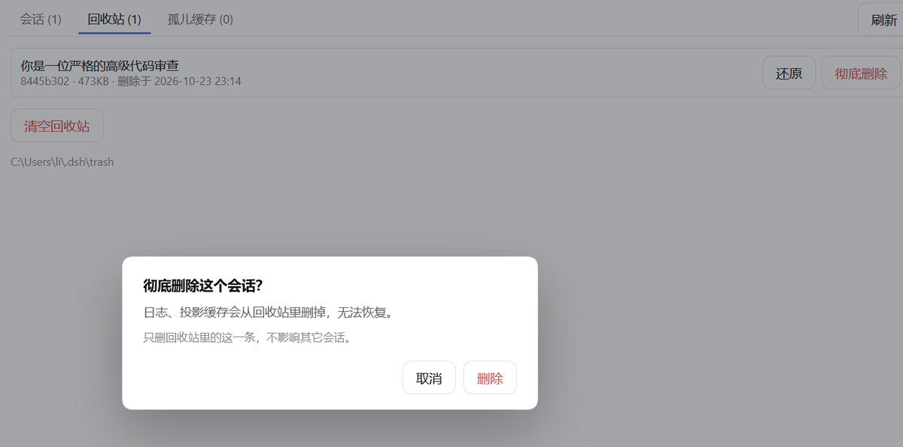

<div align="center">

# DSH Session Recycle · 会话回收站

**给 DeepSeek Harness 的会话加一个垃圾桶。**

右键删除 → 进回收站 → 随时还原。删得干净，也留得住回旋的余地。

[](LICENSE)
[](#环境要求)
[](https://github.com/liii-Boo/dsh-session-recycle/releases)
[](https://github.com/liii-Boo/dsh-session-recycle/stargazers)
[](#环境要求)

DSH 只提供「归档」，没有「删除」——归档只是把会话藏起来，日志文件仍然留在磁盘上。<br>
这个插件补上真正的删除：删掉的会话移进 `~/.dsh/trash`，侧栏立刻消失，需要时随时还原。<br>
删除时**日志目录、登记表、投影缓存三处一起处理**，不会留下点不开的幽灵条目。

</div>

---

> [!IMPORTANT]
> **删除 = 移进回收站，可以还原。** 只有点「彻底删除」或「清空回收站」才会真正释放磁盘空间。
> 第一次使用前，建议先备份 `~/.dsh/sessions` 和 `~/.dsh/storages` 这两个目录。

<details>
<summary><b>English</b></summary>

**DSH Session Recycle** — a recycle bin for [DeepSeek Harness](https://github.com/deepseek-ai/deepseek-harness) sessions.

DSH only ships *archive*, not *delete*: archiving hides a session but leaves its log on disk.
This plugin adds real deletion with an undo path — a deleted session moves to `~/.dsh/trash`
instead of vanishing and can be restored at any time. It cleans all three places a session lives
(log directory, `workspace.json` ledger, projection cache), so no ghost rows are left behind.
Also included: batch delete, cleanup by age, and orphan-cache diagnosis.

</details>

## 这是什么

DSH 只有「归档」，没有「删除」——会话层的接口里根本没有 `deleteSession`，日志是只追加的，
归档只是把会话藏起来，文件还躺在 `~/.dsh/sessions` 里。

这个插件补上删除，但不是直接 `rm -rf`：

```
右键「删除会话」→ 移进 ~/.dsh/trash → 侧栏立刻消失 → 需要时还原
```

只有你在回收站里点「彻底删除」或「清空」，磁盘空间才真正释放。

## 为什么不是又一个删目录的脚本

删得不干净是这类插件的通病。一个会话其实散在**三个地方**：

| 位置 | 内容 |
|---|---|
| `~/.dsh/sessions/<工作区>/session-<id>/` | 日志本体 |
| `~/.dsh/storages/workspace.json` | 归属登记 + 归档/置顶集合 |
| `~/.dsh/storages/session_projcache/sessions/<id>.json` | 投影缓存（标题、轮数、最后提问时间） |

只删第一个，侧栏会留下看不见的幽灵行、会话掉进"未分组"、标题变空白。
本插件三处一起处理，并且**还原时连归档/置顶标记一起还回来**。

## 功能

**右键菜单**
- 删除会话 → 二次确认 → 进回收站

**侧栏入口**（设置里可开关）
- 侧栏多一个回收站图标，点进去就是完整面板，不用每次翻设置

**面板三个页签**

| 页签 | 能做什么 |
|---|---|
| 会话 | 勾选批量删除；按「N 天前未活动」+「只看 0 轮空会话」一键选中 |
| 回收站 | 列表、还原、彻底删除、清空 |
| 孤儿缓存 | 找出"只有缓存没日志"和"登记了但日志没了"的残留，一键清理 |

## 安装

```powershell
dsh plugin --profile <你的 profile> add @liii-boo/dsh-session-recycle
```

装完重启 DSH。右侧「设置 → 会话回收站」就是面板。

> **桌面版（Electron）注意**：`desktop` profile 由应用独占，上面这条命令会被拒绝
> （`profile "desktop" is managed exclusively by the Electron application`）。
> 请在 **设置 → 插件** 里安装，或让 agent 帮你完成"pnpm 安装 + 写入 `dsh.profile.bundles`"。

**从 Release 安装**（推荐，不需要 npm 账号）：

1. 打开 [Releases](https://github.com/liii-Boo/dsh-session-recycle/releases/latest)，下载 `liii-boo-dsh-session-recycle-1.0.0.tgz`
2. 执行：

```powershell
dsh plugin --profile <你的 profile> add <tgz 的绝对路径>
```

**直接用 git 装**：

```powershell
dsh plugin --profile <你的 profile> add https://github.com/liii-Boo/dsh-session-recycle
```

**卸载**：设置 → 插件 → 找到本插件 → 删除，然后重启。

## 使用

| 想做的事 | 怎么做 |
|---|---|
| 删一个会话 | 侧栏会话行右键 → 删除会话 → 确认 |
| 一次删一堆 | 侧栏回收站图标（或设置页）→「会话」页签 → 勾选 → 删除所选 |
| 清理很久没动的空会话 | 同上 → 填天数、勾「只看 0 轮的空会话」→ 选中符合条件的 → 删除所选 |
| 找回来 | 「回收站」页签 → 还原 |
| 真正释放磁盘 | 「回收站」页签 → 彻底删除 / 清空回收站（不可撤销） |
| 清理幽灵条目 | 「孤儿缓存」页签 → 一键清理全部 |

侧栏那个图标不想要：设置 → 会话回收站 → 侧栏入口 → 选「不显示」。设置页的入口一直都在。

## 截图

**回收站列表与「彻底删除」确认**



> 侧栏入口、右键菜单的截图待补。

## 环境要求

| 项 | 要求 |
|---|---|
| DSH | `0.2.0-rc.1` / `0.2.0-rc.2` / `0.2.1-rc.1` / `0.2.1-rc.2`（在 `0.2.1-rc.2` 上开发和验证） |
| Node | `^22.19.0 \|\| >=24.0.0`（只是开发/测试需要，插件本体跑在宿主里） |
| 平台 | Windows / macOS / Linux（宿主是 Electron 也行；文件占用重试对 Windows 有专门处理） |

## 它做了什么（给想读代码的人）

删除的顺序是有讲究的，顺序错了会留下半截日志：

```
1. 走宿主的 workspace/session-stop（jobs / subagent / schedule 都挂在这条通道上）
2. 等 session/disposed 级联落地，再把 runtime detach
3. 日志目录 + 投影缓存 → ~/.dsh/trash/<时间戳>/<id>/
4. 复查缓存有没有被 dispose 的回写重新写出来，有就再搬一次
5. 登记表摘除（走 workspaceRegistry 服务，文件层兜底）+ 广播 api-session/removed
```

还原则相反，而且是**通过 `workspaceRegistry` 登记**，不是直接改 `workspace.json`——
注册表以内存快照为权威，直接改文件会被宿主下一次写入覆盖。

其余细节：文件搬运用了重试（Windows 上 detach 后句柄可能还没释放）、`meta.json` 先写
（失败可回滚）、路径参数都过白名单（防穿越）、写操作串行化（防并发覆盖登记表）。

## 安全

- 所有写接口三重校验：socket 回环 + `Host` 是本机 + `Sec-Fetch-Site`/`Origin` 同源，另外优先用宿主自己的 `connection.requestRejection`
- 删除**只是搬家**，可还原；只有「彻底删除 / 清空」不可撤销
- 动手前建议先备份一次：`~/.dsh/sessions` 和 `~/.dsh/storages`（尤其第一次用）

## 子代理会话（subagent）也支持

DSH 的子代理会话在磁盘上的目录名是**裸 uuid**（如 `8445b302-d5ec-…`），没有 `session-` 前缀，
特殊字符还会被编码成 `~XXXX`。本插件按“目录里有没有会话日志文件”识别会话，
因此子会话同样会被列出、可删除、可还原，它的投影缓存也不会被误判成孤儿。

## 已知边界

- 回收站不设上限、不自动过期，占多少磁盘由你决定
- 还原不重建会话的 runtime，界面上要切一次工作区或按 F5 才看得到
- 只处理本机 `DSH_HOME`，不涉及远程主机
- 批量删除一次上限 500 条（只防手滑）

## 开发

```powershell
npm test                       # 16 个离线单测：回收站往返、标记还原、孤儿清理、路径白名单、冲突处理…
node test/lint-package.mjs .   # 发布前一致性自检（包名/patch/入口/LICENSE 等 12 项）
```

单测在临时目录里造一套假的 `~/.dsh`（通过 `DSH_HOME` 切换），不需要启动 DSH。

## License

[MIT](LICENSE) © 2026 liii-Boo

